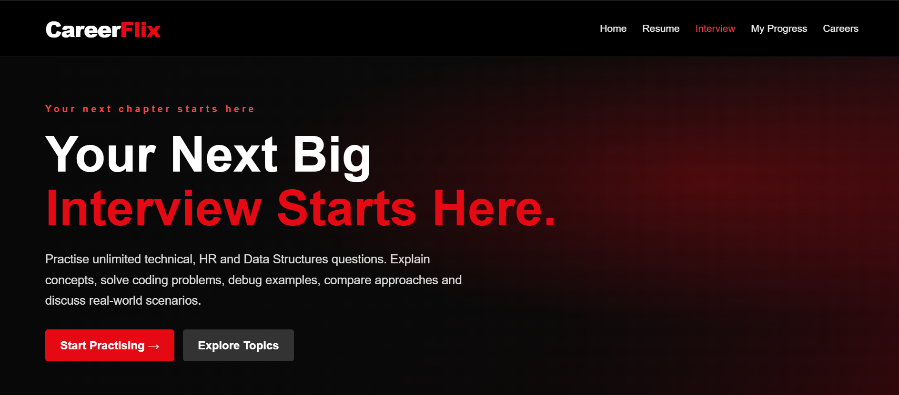
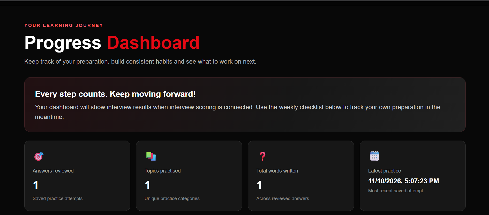

# CareerFlix AI 🚀

An AI-powered interview preparation and career practice platform designed to help students improve their interview skills, practice technical questions, and track their learning progress.

## 🌟 About the Project

CareerFlix AI is a web-based application built using Python and Flask. It provides an interactive environment for interview preparation, open-ended question practice, answer improvement suggestions, and progress tracking.

The platform aims to make interview preparation more organized and accessible for students.

## ✨ Features

- **Interview Practice:** Practice with dynamically generated open-ended interview questions.
- **Previous & Next Question:** Navigate between questions while preserving your typed answer draft during the practice session.
- **Answer Review:** Get a checklist and suggestions to improve the structure and clarity of your answers.
- **Progress Dashboard:** View saved practice attempts, topic statistics, recent answers, and suggestions.
- **Practice History:** Save reviewed answers in browser local storage.
- **User-Friendly Interface:** Simple and interactive web interface.

*Note: Answer review suggestions focus on writing structure and clarity; they are not a guaranteed evaluation of technical correctness.*

## 🛠️ Technologies Used

- Python
- Flask
- HTML
- CSS
- JavaScript
- Local Storage
- PyPDF
- Sentence Transformers
- Scikit-learn

## 📂 Project Structure

```text
CareerFlix-AI/
│
├── app.py
│
├── Templates/
│   ├── index.html
│   ├── interview.html
│   ├── progress.html
│   ├── resume.html
│   └── JOBS.HTML
│
├── static/
│   ├── script.js
│   └── style.css
│
└── README.md
```

## ⚙️ Installation & Setup

### 1. Clone the Repository

```bash
git clone https://github.com/Yashvi-1914/CareerFlix-AI.git
```

### 2. Open the Project Folder

```bash
cd CareerFlix-AI
```

### 3. Install Dependencies

```bash
pip install flask pypdf sentence-transformers scikit-learn
```

### 4. Run the Application

Open `app.py` in Thonny and click **Run**.

### 5. Open in Browser

Interview Practice:

```text
http://127.0.0.1:5001/interview
```

Progress Dashboard:

```text
http://127.0.0.1:5001/progress
```

## 📊 Progress Tracking

CareerFlix AI maintains reviewed practice attempts in the browser's local storage and displays progress information in the Progress Dashboard.

Practice history is browser-specific and may be lost if browser site data is cleared.

## 🎯 Project Objective

The main objective of CareerFlix AI is to help students practice interview questions, improve their communication and answer structure, and monitor their preparation journey through an interactive platform.

GitHub: [Yashvi-1914](https://github.com/Yashvi-1914)

## 📌 Repository

[CareerFlix-AI on GitHub](https://github.com/Yashvi-1914/CareerFlix-AI)

---

⭐ If you find this project interesting, consider giving the repository a star!

## 📸 Application Screenshots

### Interview Practice


### Progress Dashboard


## 👩‍💻 Developer
**Yashvi Agarwal**
